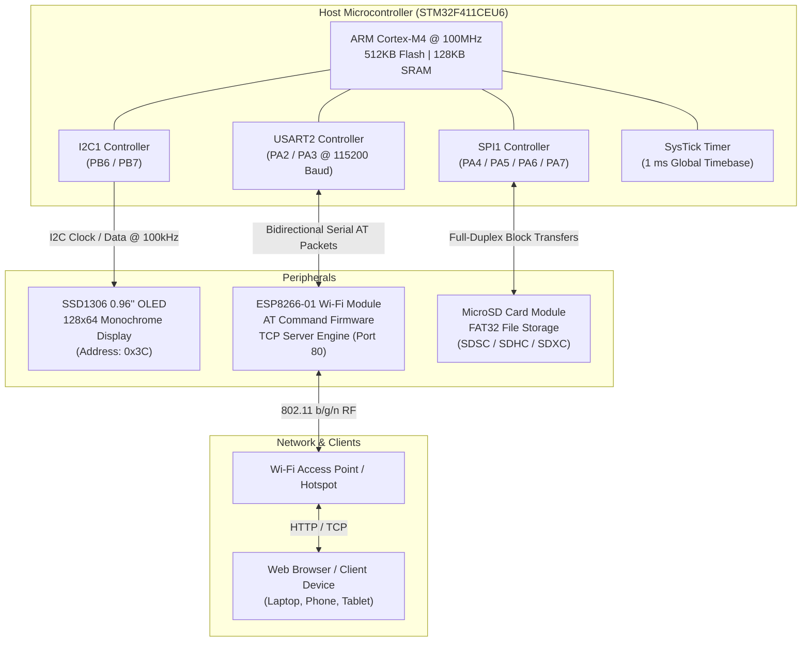
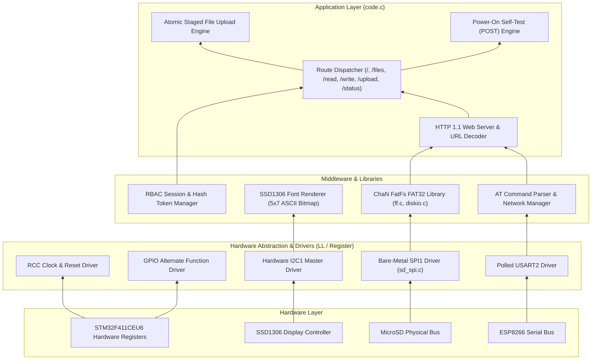
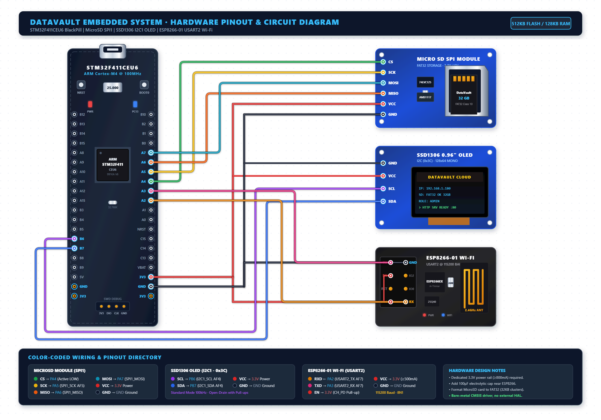
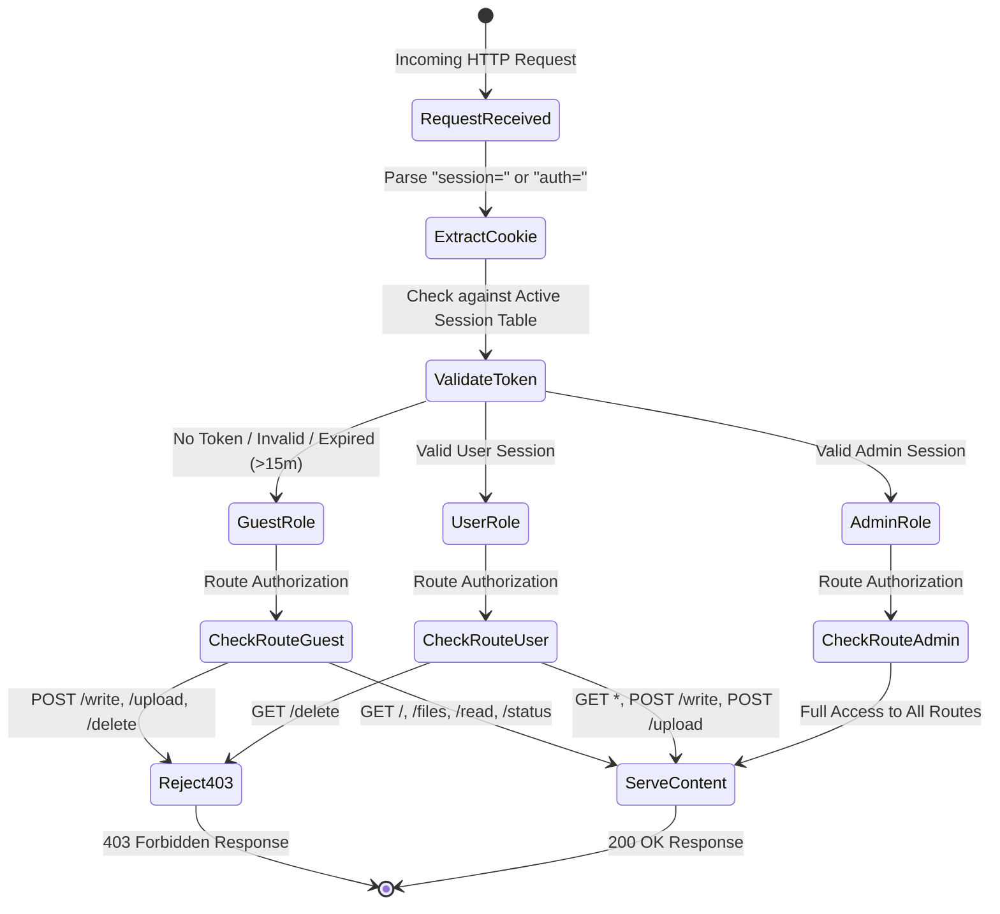
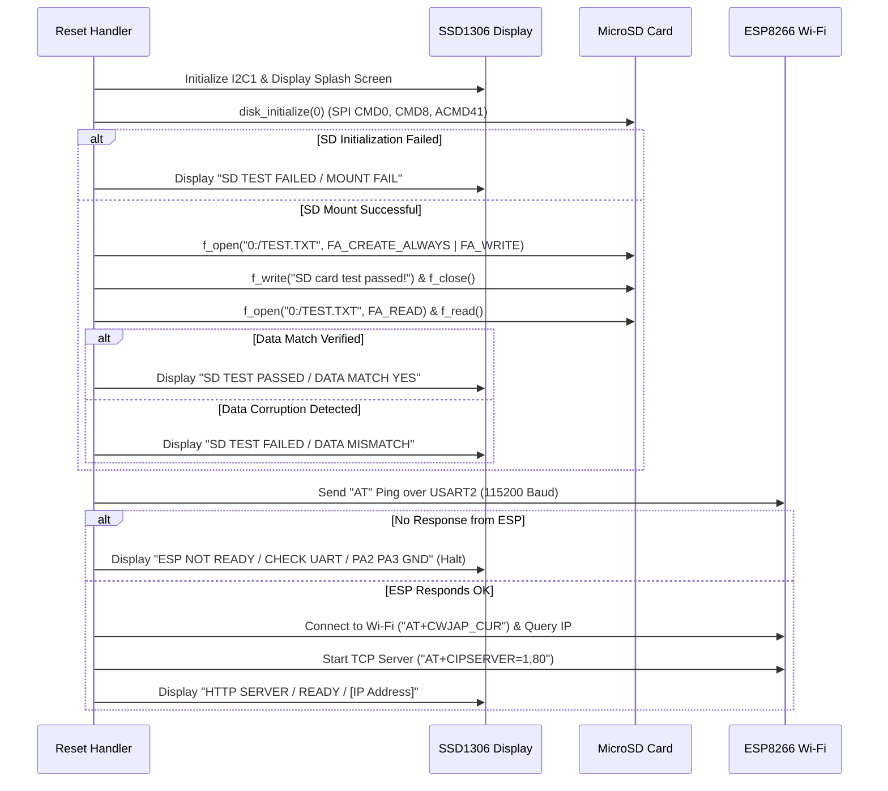

# DataVault: Mini Multi-User Networked Data Center

<p align="center">
  
  
  
  
  
  
  
</p>

> **A high-performance, bare-metal embedded private cloud and networked storage server built on the STM32F411 (ARM Cortex-M4).**
>
> DataVault turns an STM32 microcontroller, an ESP8266 Wi-Fi module, a MicroSD card, and an OLED display into a standalone personal cloud server. It serves a responsive, dark-mode web portal over HTTP with multi-user role-based authentication, drag-and-drop atomic file uploads, real-time file viewing/downloading, and synchronized hardware display telemetry.

---

## Table of Contents
1. [Overview & Core Features](#overview--core-features)
2. [System Architecture](#system-architecture)
3. [Hardware Specifications & BOM](#hardware-specifications--bom)
4. [Pinout & Hardware Wiring](#pinout--hardware-wiring)
5. [Firmware & Software Subsystems](#firmware--software-subsystems)
   - [Bare-Metal Peripheral Drivers](#1-bare-metal-peripheral-drivers)
   - [MicroSD SPI Driver & FatFs Integration](#2-microsd-spi-driver--fatfs-integration)
   - [ESP8266 AT Command & HTTP Server Engine](#3-esp8266-at-command--http-server-engine)
   - [Role-Based Access Control (RBAC) & Sessions](#4-role-based-access-control-rbac--session-management)
   - [Atomic File Upload Pipeline](#5-atomic-file-upload-pipeline)
   - [SSD1306 OLED Telemetry Driver](#6-ssd1306-oled-telemetry-driver)
6. [Web Portal Experience](#web-portal-experience)
7. [HTTP RESTful API Reference](#http-restful-api-reference)
8. [Power-On Self-Test (POST) Diagnostics](#power-on-self-test-post-diagnostics)
9. [Memory Footprint & Resource Utilization](#memory-footprint--resource-utilization)
10. [Getting Started & Build Instructions](#getting-started--build-instructions)
11. [Troubleshooting & Diagnostics](#troubleshooting--diagnostics)
12. [Repository Directory Structure](#repository-directory-structure)
13. [Author & Credits](#author--credits)

---

## Overview & Core Features

Traditional cloud storage systems depend on remote servers, external subscriptions, and high-power computers. **DataVault** demonstrates how a high-efficiency 32-bit ARM Cortex-M4 microcontroller can deliver a complete, multi-user networked storage experience in a compact, low-power embedded form factor.

- **Embedded HTTP Web Server (Port 80)**: Fully handled via non-blocking multi-connection TCP (`AT+CIPMUX=1` / `AT+CIPSERVER=1,80`) on the ESP8266.
- **FAT32 MicroSD Storage**: Full filesystem capabilities powered by ChaN FatFs R0.14+ over hardware SPI1 with partition metric computation, volume size tracking, and cluster management.
- **Multi-User Role-Based Access Control (RBAC)**:
  - **Admin**: Full control — file browsing, downloading, live in-browser editing/creation, appending, and deletion.
  - **User**: Standard collaboration — file browsing, downloading, editing/creation, and appending.
  - **Guest**: Secure read-only access — public file browsing, in-browser viewing, and downloading.
- **Atomic File Uploads (Up to 2 MB)**: Chunked data reception with progress telemetry, written to an intermediate staging file (`UPLOAD.TMP`) and atomically renamed upon CRC/close verification to prevent partial-write corruption.
- **Live In-Browser Code & Text Viewer**: Previews `.TXT`, `.LOG`, `.CSV`, `.HEX`, `.C`, `.H`, `.MD`, and `.DAT` files with HTML entity escaping to protect against XSS injection.
- **Real-Time OLED Hardware Monitor**: SSD1306 128x64 display driven over I2C1 showing startup self-tests, Wi-Fi status, DHCP station IP, live file operations, and system health metrics.
- **Power-On Self-Test (POST)**: Automatic file read-back validation at boot to confirm card health and filesystem integrity before accepting network traffic.

---

## System Architecture

### Hardware Interconnect Diagram



### Firmware Software Stack



---

## Hardware Specifications & BOM

| Component | Specification / Part Number | Key Characteristics | Quantity |
| :--- | :--- | :--- | :---: |
| **Microcontroller** | **STM32F411CEU6 ("BlackPill")** | ARM Cortex-M4 with FPU, 512 KB Flash, 128 KB SRAM, up to 100 MHz clock | 1 |
| **Wi-Fi Module** | **ESP8266 (ESP-01 / ESP-12)** | 802.11 b/g/n, Ai-Thinker AT command firmware (v1.7+), UART @ 115200 baud | 1 |
| **Storage Media** | **MicroSD Card Module** | SPI interface with onboard 3.3V LDO / buffer, supports SDSC & SDHC (FAT32) | 1 |
| **MicroSD Card** | 8 GB – 32 GB Class 10 | Formatted to FAT32 with 32 KB cluster size | 1 |
| **Status Display** | **SSD1306 0.96" OLED** | 128x64 resolution, I2C interface, address `0x3C`, monochrome blue/white | 1 |
| **Power Supply** | 3.3V Dedicated LDO / Buck (>= 800 mA) | Decoupled supply to absorb ESP8266 RF transmission spikes (up to 250 mA) | 1 |
| **Debugger** | ST-Link V2 / CMSIS-DAP | SWD interface (`SWCLK`, `SWDIO`) for flashing and debugging | 1 |

> [!IMPORTANT]
> **Power Supply Recommendation**: The ESP8266 draws current bursts of 200–250 mA during Wi-Fi transmission. Powering the ESP8266 directly from the onboard 3.3V pin of a basic ST-Link or cheap clone board may cause brownout resets. Use a high-current 3.3V regulator with a 100 µF capacitor across `VCC` and `GND` near the ESP8266.

---

## Pinout & Hardware Wiring

### Circuit Layout & Interconnect Diagram

<p align="center">
  
</p>

> [!TIP]
> A scalable vector version is also available at [`circuit_diagram.svg`](circuit_diagram.svg) for infinite zoom and high-resolution printing.

### Comprehensive Pin Mapping Table

| Peripheral | Signal | STM32F411 Pin | Mode / Alternate Function | Electrical Characteristics | Target Device Pin |
| :--- | :--- | :--- | :--- | :--- | :--- |
| **MicroSD Card** | **CS** | `PA4` | GPIO Output (`MODER=01`) | Push-Pull, High-Speed, Active LOW | `CS` |
| | **SCK** | `PA5` | Alternate Function 5 (`AFR[0]=5`) | Push-Pull, High-Speed (SPI1_SCK) | `SCK` / `CLK` |
| | **MISO** | `PA6` | Alternate Function 5 (`AFR[0]=5`) | Input with Internal Pull-Up (SPI1_MISO) | `MISO` / `DO` |
| | **MOSI** | `PA7` | Alternate Function 5 (`AFR[0]=5`) | Push-Pull, High-Speed (SPI1_MOSI) | `MOSI` / `DI` |
| **SSD1306 OLED** | **SCL** | `PB6` | Alternate Function 4 (`AFR[0]=4`) | Open-Drain, Pull-Up (I2C1_SCL) | `SCL` |
| | **SDA** | `PB7` | Alternate Function 4 (`AFR[0]=4`) | Open-Drain, Pull-Up (I2C1_SDA) | `SDA` |
| **ESP8266 Wi-Fi**| **TX (MCU)** | `PA2` | Alternate Function 7 (`AFR[0]=7`) | Push-Pull, High-Speed (USART2_TX) | `RXD` (ESP8266) |
| | **RX (MCU)** | `PA3` | Alternate Function 7 (`AFR[0]=7`) | Input Floating (USART2_RX) | `TXD` (ESP8266) |
| | **CH_PD / EN** | — | Tied to 3.3V | Chip Enable | `CH_PD` / `EN` |
| **Debug / SWD** | **SWDIO** | `PA13` | Dedicated Debug Port | Serial Wire Data Input/Output | ST-Link SWDIO |
| | **SWCLK** | `PA14` | Dedicated Debug Port | Serial Wire Clock | ST-Link SWCLK |
| **Power** | **3.3V** | `3.3V` | Power Rail | Regulated 3.3V DC (Common VCC) | All Modules VCC |
| | **GND** | `GND` | Ground Reference | Common System Ground | All Modules GND |

---

## Firmware & Software Subsystems

### 1. Bare-Metal Peripheral Drivers
All peripherals on the STM32F411 are configured directly through memory-mapped CMSIS registers without the overhead of heavy third-party HALs:
- **SysTick Timer**: Sourced from the processor clock, configured for 1 ms tick interrupts (`SysTick_Handler`) providing monotonic time tracking (`g_ms`) for delays and session expiration.
- **GPIO Clock & Moder**: AHB1 clock gating enabled for `GPIOA` and `GPIOB`. Alternate function registers (`AFR[0]`) route peripherals to their corresponding pads.
- **I2C1 Controller**: Configured for Standard Mode (100 kHz) at 16 MHz APB1 clock (`CR2=16`, `CCR=80`, `TRISE=17`). Implements robust bus-busy checks, START/ADDR/TXE/BTF flag timeouts, and automatic bus recovery.
- **USART2 Controller**: Configured for 115200 baud, 8 data bits, 1 stop bit, no parity (`CR1_TE | CR1_RE | CR1_UE`), with a software circular receive buffer.

### 2. MicroSD SPI Driver & FatFs Integration
The SD card subsystem communicates over SPI1 in Motorola Mode 0 (CPOL=0, CPHA=0):
- **Card Initialization Protocol**:
  1. Sends 80+ dummy clock pulses with `CS` high to enter native SPI mode.
  2. Sends `CMD0` (Software Reset) until card replies with `0x01` (Idle state).
  3. Sends `CMD8` (Send Interface Condition) to query voltage compatibility (checks for `0x1AA` pattern).
  4. Periodically sends `ACMD41` (Init Card) with HCS bit set until the card exits idle state (`0x00`).
  5. Sends `CMD58` (Read OCR) to distinguish between Standard Capacity (SDSC - byte addressing) and High/Extended Capacity (SDHC/SDXC - block addressing).
- **FatFs Glue Layer (`diskio.c`)**: Bridges the ChaN FatFs core (`ff.c`) with `sd_spi.c`. Implements `disk_initialize`, `disk_status`, `disk_read`, `disk_write`, and `disk_ioctl` (`CTRL_SYNC`, `GET_SECTOR_COUNT`, `GET_BLOCK_SIZE`).

### 3. ESP8266 AT Command & HTTP Server Engine
Network connectivity is established using standard AT commands:
- **Initialization Sequence**:
  - `AT`: Sanity ping; verifies baud rate synchronization.
  - `ATE0`: Disables local echo to minimize UART buffer parsing overhead.
  - `AT+CWMODE_CUR=1`: Sets station mode (STA).
  - `AT+CWJAP_CUR="SSID","PASS"`: Connects to the target Wi-Fi access point.
  - `AT+CIFSR`: Extracts the dynamically assigned station IP address via string token parsing.
  - `AT+CIPMUX=1`: Enables multiple TCP connections (links 0 to 4).
  - `AT+CIPSERVER=1,80`: Starts the TCP HTTP server on port 80.
- **Incoming Packet Demultiplexing**: Parses incoming `+IPD,<link_id>,<len>:` streams from the ESP8266, buffering HTTP request lines and handling chunked transmissions.

### 4. Role-Based Access Control (RBAC) & Session Management
Security is enforced at the HTTP dispatch layer:



- **Credential Database**:
  - `admin` : `Admin@2026` (Role: `ROLE_ADMIN`)
  - `user`  : `User@2026`  (Role: `ROLE_USER`)
- **Session Tokens**: 8-character hexadecimal random tokens generated using a dynamic hash seeded by hardware timer ticks and the `SysTick->VAL` register. Sessions automatically time out after **15 minutes (900 seconds)** of inactivity.
- **Path Traversal Protection (`HTTP_ValidateFilename`)**: Strips/rejects any characters outside `[a-zA-Z0-9_.-() ]`, disallows leading `.` or `/`, and restricts filenames to 32 characters, preventing directory traversal attacks (`../`).

### 5. Atomic File Upload Pipeline
Uploading files to flash/FAT storage over microcontrollers can risk filesystem corruption if the client disconnects halfway through. DataVault implements an **atomic staging pipeline**:
1. When `POST /upload?name=<filename>` begins, the server creates `0:/UPLOAD.TMP`.
2. As `+IPD` stream buffers arrive, they are staged in a 256-byte cache and committed in block increments using `f_write()`.
3. If the connection drops or errors, `HTTP_AbortUpload()` deletes `UPLOAD.TMP`.
4. When all bytes are received and verified, `HTTP_FinishUpload()` flushes the file, deletes any preexisting file with the target name, and renames `UPLOAD.TMP` to the target name.

### 6. SSD1306 OLED Telemetry Driver
The OLED driver maintains an ASCII text renderer using an embedded 5x7 bitmap font:
- **Memory Addressing**: Implements Page Addressing Mode (8 pages of 128 bytes each).
- **Diagnostics Display**:
  - Splash screen: `DATAVAULT / PRIVATE CLOUD / STM32 + FAT32 / WIFI STARTING`
  - POST diagnostics: `SD FILE TEST / WRITE READ OK / DATA MATCH YES`
  - Network status: Assigned IP address displayed clearly for easy browser discovery.
  - Real-time activity ticker: `LOGIN OK`, `UPLOAD OK`, `DELETED`, `DOWNLOAD OK`, `RBAC BLOCKED`.
  - System Telemetry Mirror: Mirrored live view of uptime, storage usage percentage, and active user role.

---

## Web Portal Experience

The web interface is served directly from microcontroller Flash with modern CSS styling:
- **Ultra-Lightweight (~1.5 KB)**: Inlined vanilla CSS with zero external CDN dependencies — works completely offline on isolated local networks.
- **Dark-Mode Aesthetic**: Minimalist deep black `#000` with subtle border contrasts (`#262626`), card grouping, and status badges.
- **Mobile-Responsive**: Designed with flexible viewport tags and grid systems that scale cleanly from smartphones to desktop browsers.

### UI Screens

#### 1. Home Dashboard (`/`)
Displays real-time storage metrics, volume card type, total and free space in megabytes, a dynamic HTML/CSS usage bar, a drag-and-drop file upload zone (supporting files up to 2 MB), active user role badge, and quick navigation.

```
+--------------------------------------------------+
| DataVault               [ Admin ]  [ Logout ]    |
| Private Cloud                                    |
+--------------------------------------------------+
| Storage                                   FAT32  |
| TOTAL: 29724 MB              FREE: 29540 MB      |
+--------------------------------------------------+
| Upload                                           |
| +----------------------------------------------+ |
| |        Drop a file here                      | |
| |        or tap to choose (max 2MB)            | |
| +----------------------------------------------+ |
+--------------------------------------------------+
| Navigation                                       |
| [ Files ]    [ Write ]    [ Status ]    [ Home ] |
+--------------------------------------------------+
| Signed in as admin                               |
+--------------------------------------------------+
```

#### 2. File Explorer (`/files`)
Tabulates every file stored on the MicroSD card, displaying exact file size in bytes or KB, with quick actions:
- `View`: Opens the text/code viewer.
- `Get`: Streams binary file download to client.
- `Del`: Deletes file from card (Admin role only, with confirmation alert).

#### 3. Live System Telemetry (`/status`)
Provides real-time hardware vitals:
- Server station IP address
- System uptime (`Xh Ym Zs`)
- Microcontroller identifier (`STM32F411`)
- Storage utilization breakdown and percentage bar
- Simultaneously synchronizes and mirrors this telemetry onto the physical OLED screen!

---

## HTTP RESTful API Reference

| Method | Endpoint | Parameters / Payload | Auth Level | Responses | Description |
| :--- | :--- | :--- | :--- | :--- | :--- |
| `GET` | `/` | — | Any | `200 OK` | Serves main DataVault dashboard and upload portal. |
| `GET` | `/files` | — | Any | `200 OK` | Lists files and directories on the SD card root. |
| `GET` | `/read` | `?name=<filename>` | Any | `200 OK`, `400`, `404`, `415` | Previews readable text/code files with HTML escaping. |
| `GET` | `/download` | `?name=<filename>` | Any | `200 OK`, `400`, `404` | Streams raw binary file attachment (`application/octet-stream`). |
| `GET` | `/write` | — | User, Admin | `200 OK`, `403` | Renders file creator and text editor form. |
| `POST` | `/write` | `name`, `mode`, `content`, `auth` | User, Admin | `200 OK`, `400`, `403`, `500` | Creates or appends text content to a specified file. |
| `POST` | `/upload` | `?name=<filename>` + raw stream | User, Admin | `200 OK`, `400`, `403`, `500` | Atomically uploads binary or text file (up to 2 MB). |
| `GET` | `/delete` | `?name=<filename>&auth=<tok>` | **Admin Only** | `302 Found`, `400`, `403`, `500` | Unlinks and deletes the specified file from the SD card. |
| `GET` | `/status` | — | Any | `200 OK` | Returns hardware telemetry and mirrors to OLED screen. |
| `GET` | `/login` | — | Any | `200 OK` | Renders the authentication login form. |
| `POST` | `/login` | `user`, `pass` | Any | `302 Found`, `200 OK` (fail) | Validates credentials, sets `session` cookie, and redirects. |
| `GET` | `/logout` | — | Any | `302 Found` | Invalidates active session token and clears cookie. |

---

## Power-On Self-Test (POST) Diagnostics

During startup, the system executes a comprehensive self-diagnostic routine before entering the main loop:



---

## Memory Footprint & Resource Utilization

The application is compiled using **ARM Compiler 6 (ARMCLANG)** with `-Oz` (extreme size optimization):

| Memory Region | Target Device Limit | Firmware Utilization | Headroom Remaining |
| :--- | :--- | :--- | :--- |
| **Flash Memory (ROM)** | **512 KB** (0x08000000 - 0x08080000) | **~68 KB** (~13.3% utilized) | **> 440 KB free** |
| **SRAM Memory (RAM)** | **128 KB** (0x20000000 - 0x20020000) | **~24 KB** (~18.8% utilized) | **> 100 KB free** |

### Internal Buffer Allocation
- `http_request`: 2048 Bytes (stores complete `+IPD` MTU chunk and HTTP request headers)
- `http_response`: 5200 Bytes (transmits chunked HTML output with headers)
- `http_body`: 4800 Bytes (assembles dynamic templates and directory file lists)
- `upload_staging`: 256 Bytes (intermediate flash alignment buffer for SD writes)
- `g_sessions`: 2 active slots with LRU eviction and 15-minute expiration

---

## Getting Started & Build Instructions

### Prerequisites
1. **Keil MDK-ARM v5.x** (with Arm Compiler Version 6 enabled).
2. **Keil STM32F4xx DFP Pack** (`Keil.STM32F4xx_DFP.2.17.1` or newer).
3. **Hardware**: STM32F411CEU6 board, ESP8266 module, MicroSD SPI adapter, SSD1306 OLED, ST-Link V2.

### Step-by-Step Instructions

#### 1. Clone the Repository
```bash
git clone https://github.com/Dakshin10/datacenter_embedded_systems.git
cd datacenter_embedded_systems
```

#### 2. Configure Your Wi-Fi Credentials
Open [`code.c`](file:///d:/Dakshin_colledge_sem5/Embedded%20Systems/datacenter_projecwt/datacenter_project/code.c) and update the Wi-Fi credentials at the top of the file:
```c
#define WIFI_SSID       "Your_Hotspot_Name"
#define WIFI_PASSWORD   "Your_Hotspot_Password"
```

#### 3. Build with Keil uVision
1. Double-click `datacenter_project.uvprojx` to launch Keil uVision.
2. Verify that **ARMCLANG (Arm Compiler 6)** is active under **Project -> Options for Target -> Target**.
3. Under the **C/C++ (AC6)** tab, confirm optimization is set to **-Oz**.
4. Press `F7` (or click **Project -> Build Target**).
5. Ensure 0 Errors and 0 Warnings.

#### 4. Flash Firmware to Microcontroller
- **Directly from Keil**: Connect ST-Link and press `F8` (or click **Flash -> Download**).
- **Using STM32CubeProgrammer CLI** (with the pre-built `datacenter_project.hex`):
  ```bash
  STM32_Programmer_CLI -c port=SWD -w datacenter_project.hex -v -rst
  ```

#### 5. Launch & Access the Cloud
1. Power up the board. The OLED will show the boot sequence and self-test.
2. Wait for the OLED to display:
   ```
   HTTP SERVER
   SERVER READY
   192.168.X.Y
   ```
3. Open any web browser on a phone, laptop, or PC connected to the same Wi-Fi network and navigate to:
   ```
   http://192.168.X.Y
   ```
4. Sign in with the **Admin** (`admin` / `Admin@2026`) or **User** (`user` / `User@2026`) credentials to begin storing, reading, and managing your files!

---

## Troubleshooting & Diagnostics

| Symptom / OLED Message | Probable Root Cause | Resolution |
| :--- | :--- | :--- |
| **`ESP NOT READY / CHECK UART / PA2 PA3 GND`** | Baud rate mismatch or wiring issue on UART2. | Verify ESP8266 TX is connected to MCU `PA3`, RX to `PA2`, and both share a common GND. Confirm the ESP8266 firmware baud rate is 115200. |
| **`SD TEST FAILED / MOUNT FAIL`** | SPI bus wiring fault, unformatted card, or unsupported capacity. | Check SPI1 connections (`PA4`=CS, `PA5`=SCK, `PA6`=MISO, `PA7`=MOSI). Ensure the MicroSD card is formatted to **FAT32** with 32 KB clusters (exFAT/NTFS are not supported). |
| **`SD TEST FAILED / WRITE FAIL`** | Write-protect lock or corrupted card cluster. | Ensure the SD card adapter write-protect switch is unlocked. Try re-formatting or testing with another card. |
| **OLED Remains Blank** | I2C address conflict or bus lockup. | Confirm SSD1306 I2C address is `0x3C`. Ensure pull-up resistors (4.7 kΩ) are present on `PB6` (SCL) and `PB7` (SDA) if the OLED breakout module lacks onboard pull-ups. |
| **ESP Brownout / Reboot during Wi-Fi join** | Current starvation from 3.3V rail during RF transmit bursts. | Power the ESP8266 from an external 3.3V regulator capable of at least 500 mA. Add a 100 µF electrolytic capacitor across ESP8266 `VCC` and `GND`. |
| **`CIPSERVER REJECTED` / Restart** | Port 80 socket was already bound or left unclosed from a prior boot. | The firmware automatically attempts an `ESP_Restart()` reset routine to restore clean server link states. Power cycle if persistent. |

---

## Repository Directory Structure

```
datacenter_embedded_systems/
├── .gitignore                                 # Git exclusions for Keil MDK artifacts, logs, and temp files
├── README.md                                  # Complete system engineering documentation
├── code.c                                     # Main firmware: HTTP engine, RBAC, OLED UI, web portal
├── sd_spi.c                                   # Low-level bare-metal SPI1 driver for MicroSD card
├── sd_spi.h                                   # SPI command macros, card types, and return codes
├── datacenter_project.uvprojx                 # Keil uVision 5 project definition file
├── datacenter_project.uvoptx                  # Keil uVision 5 debugger and target options
├── datacenter_project.hex                     # Production Intel HEX binary ready for flashing
├── DebugConfig/
│   └── Target_1_STM32F411CEUx.dbgconf         # Keil debugger target configuration
├── FatFs/                                     # ChaN FatFs FAT32 filesystem library
│   ├── diskio.c                               # Low-level storage interface glue layer
│   ├── diskio.h                               # Disk I/O function prototypes and status flags
│   ├── ff.c                                   # FatFs core file operations implementation
│   ├── ff.h                                   # FatFs API declarations and data structures
│   ├── ffconf.h                               # Filesystem configuration (buffers, LFN, code page)
│   ├── ffunicode.c                            # Unicode / Long Filename (LFN) lookup tables
│   └── sd_spi.h                               # SPI interface header binding
└── RTE/                                       # Keil CMSIS Run-Time Environment
    ├── Device/STM32F411CEUx/
    │   ├── startup_stm32f411xe.s              # Cortex-M4 vector table and assembly startup
    │   ├── system_stm32f4xx.c                 # System initialization and clock configuration
    │   └── STM32F401xBCDE_411xCE.dbgconf      # CMSIS-DAP debugger script
    └── _Target_1/
        └── RTE_Components.h                   # Keil RTE component header
```

---

## Author & Credits

- **Author**: **Dakshin Raj** ([@Dakshin10](https://github.com/Dakshin10))
- **Course**: Embedded Systems (Semester 5)
- **Filesystem**: [ChaN FatFs](http://elm-chan.org/fsw/ff/00index_e.html) by ChaN
- **Target Platform**: STMicroelectronics STM32F411CEU6 (ARM Cortex-M4)

---

<p align="center">
  <i>Built with passion for embedded hardware, bare-metal C programming, and low-power distributed systems.</i>
</p>